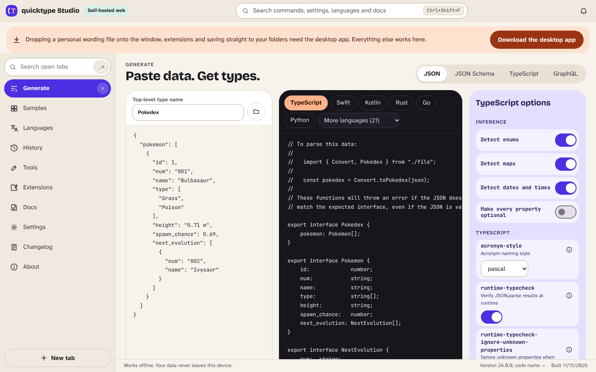
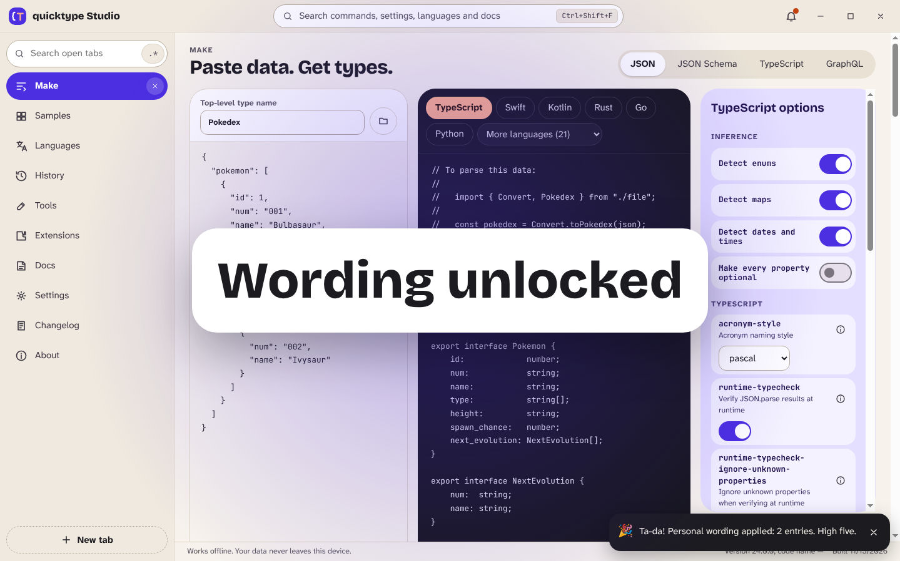

# quicktype Studio

A redesigned app for the quicktype engine: paste sample JSON, JSON Schema, TypeScript or GraphQL and get typed models with serializers in 27 languages, on your own machine.

**Website and docs:** https://ding-ding-projects.github.io/quicktype/ · **Releases:** [tags starting with `studio-v`](https://github.com/Ding-Ding-Projects/quicktype/releases?q=studio&expanded=true)

**Build and run on a fresh Windows machine:**

```bat
.\build.bat --run
```



<details>
<summary><strong>Three editions</strong></summary>

| Edition | What it is | How to get it |
| --- | --- | --- |
| Desktop app | Windows app with every feature: personal wording file drop, extensions, saving into folders, self-updating installer | Release assets `quicktype-studio-*-setup.exe` (installer) or `*-portable.exe` |
| Self-hosted container | The web edition served from your own machine to any browser on your network | `docker compose -f studio/compose.yaml up -d`, or `studio\host.bat start` on Windows |
| Appliance image | A small system image that boots straight into the web edition | Release assets `quicktype-appliance-bios.img` and `quicktype-appliance-efi.iso` |

Features that need the desktop app show a banner with a download link in the other editions.

</details>

<details>
<summary><strong>Building, testing and packaging</strong></summary>

```bash
# from the repository root
./download-dependencies.sh          # or download-dependencies.bat on Windows
npm run build --workspace quicktype-core --workspace quicktype-graphql-input --workspace quicktype-typescript-input
cd studio
npm run build:desktop               # web interface + bundled engine for the desktop app
npm test                            # unit tests (vitest)
npx electron .                      # run the desktop app from source
npm run serve                       # run the self-hosted server on port 8080
```

- `build-installer.bat` produces the Squirrel installer files and the portable `.exe` and prints their SHA-256 digests. It never publishes.
- `docker build -f studio/Dockerfile -t quicktype-studio .` from the repository root builds the container image.
- `studio/appliance/build.sh <image-ref>` builds the appliance images with LinuxKit.
- `node scripts/capture.mjs <url> <dir>` and `node scripts/capture-desktop.mjs <dir>` drive the built app in headless Chrome or Electron and save screenshots.

</details>

<details>
<summary><strong>How it fits together</strong></summary>

- `shared/engine.mjs` wraps quicktype-core. The interface runs it in a Web Worker; the server and the desktop main process run it in Node.
- `src/` is the interface (TypeScript, no framework). Every page is a tab registered in `src/pages/`.
- `desktop/` is the Electron shell: a narrow preload bridge, the extension host and the updater.
- `server/server.mjs` serves the interface plus `/api/generate`, `/api/languages`, `/api/status`, `/healthz` and the `/appliance` status page.
- `appliance/` holds the LinuxKit image recipe.
- `../site/` builds the website from `../docs/studio/`.

</details>

<details>
<summary><strong>Releases</strong></summary>

Every push to `master` runs `.github/workflows/studio-release.yaml`, which builds the Windows files, pushes the container image to `ghcr.io/ding-ding-projects/quicktype-studio`, builds the appliance images and publishes one release tagged `studio-v<version>-build.<run>`. The notes state which checks ran, the line count and the workflow timing. Release files are not code-signed. The installer's update feed is the `studio-channel` release.

</details>

<details>
<summary><strong>Line count and how long this would take by hand</strong></summary>

Line counts come from `node studio/scripts/count-lines.mjs`, which every release runs and prints in its notes. This README is refreshed from a published release, so until the first release lands no figure is shown here.

</details>


